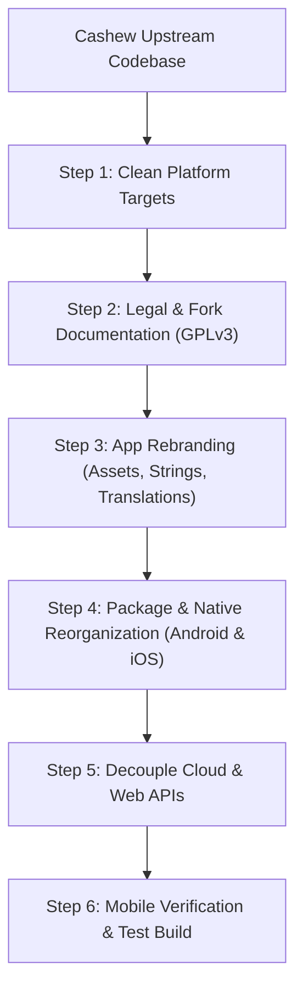

# Implementation Plan: Fork Restructure, App Renaming & GPLv3 Compliance

> **Historical plan — completed and superseded (2026-11-15).** Current identity is **OpenCashew**, Android application ID and iOS bundle identifier `org.opencashew.app`. The Flutter app now lives at the repository root. See [`walkthrough.md`](walkthrough.md) for the completion record; this file is retained as a historical proposal.

## Goal Description
Transform the project from the upstream **Cashew** repository into a fully independent, standalone mobile application fork (targeting modern Android and iOS platforms exclusively). This involves:
1. Complete removal of obsolete web and desktop platform artifacts and configurations (already initiated in workspace cleanup).
2. Proper GNU General Public License v3.0 (GPLv3) compliance, attribution of upstream author James Kokoska, preserving copyleft rights and documenting all fork modifications.
3. Decoupling upstream service endpoints, Firebase IDs, and web app links.
4. Comprehensive rebranding (app display name, package ID / bundle identifier, internal identifiers).
5. Codebase and package structure reorganization.

---

## User Review Required

> [!IMPORTANT]
> **Historical decisions in the original proposal (superseded):** The Cashly name and `com.cashly.app` identifiers were not adopted. The shipped fork identity is OpenCashew (`org.opencashew.app`).

---

## GPLv3 Legal & License Requirements

Under the GNU General Public License v3.0:
1. **Maintain Original Copyright & License**: Upstream copyright notice `Copyright (C) 2021-2024 James Kokoska` must remain intact in `LICENSE` and headers.
2. **Add Fork Notice**: A notice stating that this work is a derivative fork, stating the year and your copyright/organization, e.g.:
   ```text
   Cashew - Personal Finance & Budget Tracker
   Original Copyright (C) 2021-2024 James Kokoska
   Forked and modified (C) 2026 drshtmstry and contributors
   Licensed under GNU General Public License v3.0.
   ```
3. **Document Modifications**: A prominent notice in `README.md` and `NOTICE` / `CHANGELOG.md` stating what was altered (removed web/desktop code, updated modern Android API 36/37 and Gradle 9 / AGP 9 targets, rebranded).
4. **Remain Open Source**: The entire codebase and any future modifications distributed must remain under GPLv3.

---

## Proposed Changes



---

### 1. Platform Purge & Mobile-Only Optimization
* **Files removed / excluded**:
  - `budget/web/` (deleted)
  - `budget/windows/` (deleted)
  - `budget/firebase.json`, `budget/.firebaserc` (deleted)
  - `.github/workflows/firebase-hosting-pull-request.yml` (deleted)
  - `scripts/deploy_and_build_windows.bat` (deleted)
  - `budget/lib/database/platform/web.dart` & `unsupported.dart` (deleted)
* **Configuration updates**:
  - `pubspec.yaml`: Remove `universal_html`, `firebase_core_web`, `firebase_auth_web`.
  - `budget/.metadata`: Remove `windows` platform migration target.
  - `budget/analysis_options.yaml`: Exclude only mobile and build folders.

---

### 2. Legal, License & Fork Attribution
* **`LICENSE`**: Keep GNU GPL v3 text and add fork notice.
* **`README.md`**:
  - Update header to reflect the new app name and status as a fork of Cashew by James Kokoska.
  - Link to upstream repository with gratitude and clear GPLv3 licensing notice.
  - Remove defunct links to old web app (`budget-track.web.app`) and original Play Store / App Store listings.
* **`NOTICE` [NEW]**: Detail fork history, upstream author, date of fork, and key alterations made.

---

### 3. App Rebranding & Identity
* **`budget/lib/struct/languageMap.dart`**:
  - Change `String globalAppName = "Cashew";` to `globalAppName = "<NewName>";`
* **`budget/lib/main.dart`**:
  - Update `title: '<NewName>'` and `ValueKey('<NewName>AppMain')`.
* **`budget/assets/translations/generated/locale_*.json`** and `assets/translations/en-US.json`:
  - Update localized occurrences of `"Cashew"` (e.g. `"enjoying-cashew-question"`, auto-transaction description).
* **`budget/lib/struct/defaultPreferences.dart`**:
  - Update `"purchaseID": "<new_app_id>.pro.lifetime"`.
* **`budget/lib/struct/uploadAttachment.dart` & `exportCSV.dart` / `exportDB.dart`**:
  - Change default export and backup folder name from `"Cashew"` to `"<NewName>"`.

---

### 4. Native Android & iOS Package Restructuring

#### Android:
* **Package Directory Migration**:
  - Move Kotlin files from `budget/android/app/src/main/kotlin/com/example/budget/` to `budget/android/app/src/main/kotlin/<new_package_path>/`.
* **`budget/android/app/build.gradle`**:
  - Update `namespace "<new.application.id>"`
  - Update `applicationId "<new.application.id>"`
* **`budget/android/app/src/main/AndroidManifest.xml`**:
  - Update `package="<new.application.id>"`
  - Update `android:label="<NewAppName>"`
  - Update widget provider actions and component paths.
* **`budget/android/app/src/debug/AndroidManifest.xml` & `src/profile/AndroidManifest.xml`**:
  - Update `package="<new.application.id>"`.

#### iOS:
* **`budget/ios/Runner.xcodeproj/project.pbxproj`**:
  - Update `PRODUCT_BUNDLE_IDENTIFIER` to `<new.bundle.id>`.
* **`budget/ios/Runner/Info.plist`**:
  - Update `CFBundleDisplayName` and `CFBundleName` to `<NewAppName>`.

---

### 5. Decouple Cloud & Backend Services
* **`budget/lib/pages/aboutPage.dart` & `settingsPage.dart`**:
  - Replace `https://cashewapp.web.app/faq.html` and `policy.html` with in-app dialogs or your fork repository documentation.
  - Update GitHub repository link to point to your repository.
* **`budget/lib/widgets/accountAndBackup.dart`**:
  - Ensure cloud backup gracefully alerts when user has not configured custom Google Drive / Firebase keys, preventing crashes or invalid auth tokens.

---

## Verification Plan

### Automated Verification:
1. **Dart Static Analysis**:
   ```powershell
   cmd.exe /c "cd /d c:\Users\drshtmstry\Documents\GitHub\Cashew\budget && C:\Users\drshtmstry\Utilities\Flutter\flutter\bin\flutter.bat analyze"
   ```
2. **Android APK Compilation (Debug & Release)**:
   ```powershell
   cmd.exe /c "cd /d c:\Users\drshtmstry\Documents\GitHub\Cashew\budget && C:\Users\drshtmstry\Utilities\Flutter\flutter\bin\flutter.bat build apk --debug"
   ```
3. **Unit & Drift Schema Verification**:
   ```powershell
   cmd.exe /c "cd /d c:\Users\drshtmstry\Documents\GitHub\Cashew\budget && C:\Users\drshtmstry\Utilities\Flutter\flutter\bin\flutter.bat test"
   ```

### Manual Verification:
1. Launch app on connected Android emulator (`emulator-5554`) using VS Code launch configuration or `flutter run`.
2. Inspect app label in Android launcher and app info screen.
3. Verify local SQLite database initialization, transaction creation, budget creation, and settings persistence.
4. Verify "About" page displays the new branding, GPLv3 license terms, and proper credit to original author James Kokoska.
