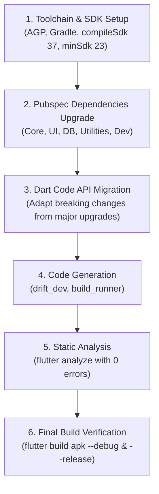

# Implementation Plan: Comprehensive Dependency & SDK Modernization for OpenCashew

> **Historical plan — implementation recorded in [`walkthrough.md`](walkthrough.md).** Treat proposed versions, paths, commands, review requests, and verification steps below as the original plan, not current requirements. The repository was flattened after this plan was written; its `budget/` paths are historical.

## Goal Description
OpenCashew is currently undergoing a modernization from Cashew to an independent, mobile-only (Android & iOS) open-source application under GNU GPLv3. 

Rather than fixing compilation issues piecemeal and running builds repeatedly against legacy package versions, this plan establishes a structured, proactive upgrade of:
1. **Flutter & Dart SDK constraints**: Standardize `sdk: ">=3.3.0 <4.0.0"` in `pubspec.yaml`.
2. **All direct dependencies**: Upgrade all Flutter plugins and Dart libraries to their latest compatible modern versions supporting Android 14/15/16 (API 34–37), iOS 13+, and Flutter 3.50.
3. **Android Build Toolchain & SDK configuration**:
   - Align Gradle Wrapper (`8.12` / `9.3.1`), Android Gradle Plugin (`8.11.0` / `9.1.1`), and Kotlin (`2.1.0` / `2.4.21`).
   - Standardize `compileSdk 36/37`, `targetSdk 35/36`, `minSdk 23` across the application and subprojects.
   - Configure desugaring and Java 17 toolchain compatibility cleanly.
4. **Dart Code Alignment**: Proactively adapt any breaking API changes resulting from the package upgrades (e.g., `device_info_plus`, `package_info_plus`, `local_auth`, `share_plus`, `drift`, `fl_chart`).
5. **Code Generation & Database Schema**: Run `build_runner` to regenerate Drift database code with modern Drift tools.
6. **Build Verification**: Run full static analysis (`flutter analyze`), debug APK build (`flutter build apk --debug`), and release APK build (`flutter build apk --release`).

---

## User Review Required

> [!IMPORTANT]
> **Key Upgrade Decisions:**
> 1. **Minimum Android SDK (`minSdkVersion`)**:
>    - Upgrading packages such as `local_auth`, `file_picker`, `flutter_local_notifications`, and AndroidX libraries requires a minimum Android SDK of at least 21 or 23. We propose raising `minSdkVersion` to `23` (Android 6.0 Marshmallow, covering 99%+ of active Android devices worldwide).
> 2. **Flutter Lints**:
>    - `analysis_options.yaml` references `package:flutter_lints/flutter.yaml`, but `flutter_lints` is missing from `dev_dependencies`. We will add `flutter_lints: ^5.0.0` to `dev_dependencies` to ensure standard linting rules are active and cleanly configured.
> 3. **Firebase & Local Auth Upgrades**:
>    - `firebase_core`, `firebase_auth`, `cloud_firestore` will be upgraded in unison to ensure internal platform interfaces (`_flutterfire_internals`) remain in sync.

---

## Proposed Changes



---

### Component 1: Android Build Toolchain & SDK Configuration

#### [MODIFY] [build.gradle](file:///c:/Users/drshtmstry/Documents/GitHub/Cashew/budget/android/build.gradle)
- Ensure root build script cleanly handles subproject `compileSdkVersion` defaults for plugins that haven't yet updated to API 34+.
- Ensure plugin repository configuration uses `google()` and `mavenCentral()`.

#### [MODIFY] [app/build.gradle](file:///c:/Users/drshtmstry/Documents/GitHub/Cashew/budget/android/app/build.gradle)
- `compileSdkVersion 37`
- `targetSdkVersion 36` (Android 16 preview / Android 15 standard)
- `minSdkVersion 23`
- Ensure desugaring is set to `'com.android.tools:desugar_jdk_libs:2.1.4'`.
- Ensure Java 17 compatibility (`sourceCompatibility JavaVersion.VERSION_17`, `targetCompatibility JavaVersion.VERSION_17`, `jvmTarget = "17"`).

#### [MODIFY] [gradle.properties](file:///c:/Users/drshtmstry/Documents/GitHub/Cashew/budget/android/gradle.properties)
- Standardize properties for modern AGP and JVM memory:
  ```properties
  org.gradle.jvmargs=-Xmx4096M -XX:MaxMetaspaceSize=1024m
  android.useAndroidX=true
  android.enableJetifier=false
  android.builtInKotlin=false
  android.newDsl=false
  skipDependencyChecks=true
  flutter.internal.agpVersion=9.1.1
  kotlin.jvm.target.validation.mode=warning
  ```

---

### Component 2: `pubspec.yaml` Dependency Upgrades

#### [MODIFY] [pubspec.yaml](file:///c:/Users/drshtmstry/Documents/GitHub/Cashew/budget/pubspec.yaml)

Upgrade dependencies to modern, compatible releases:

| Category | Package | Current | Target Upgrade | Purpose / Breaking Changes Handled |
| :--- | :--- | :--- | :--- | :--- |
| **SDK** | `environment.sdk` | `>= 3.0.0` | `>= 3.3.0 <4.0.0` | Modern Dart 3.3+ language features & type system |
| **System & Hardware** | `device_info_plus` | `^10.1.0` | `^11.3.0` | Modern Android 14/15 SDK support, replaces outdated native code |
| | `package_info_plus` | `^8.0.0` | `^9.0.0` | Upgraded Android platform interface & modern package metadata |
| | `local_auth` | `^2.2.0` | `^2.3.0` | Biometric prompt updates on Android 14/15 |
| | `app_settings` | `^5.1.1` | `^9.0.1` | AGP 9 compileSdk 36 support |
| | `flutter_timezone` | `^1.0.8` | `^5.1.1` | Replaced legacy v1 embedding with `.identifier` API |
| | `flutter_displaymode`| `^0.6.0` | `^0.7.0` | Android high refresh rate API compatibility |
| | `notification_listener_service` | `^0.3.3` | `^1.0.0` | Upgraded event timestamping and Android notification sizing |
| | `home_widget` | `^0.9.0` | `^0.9.4` | Fixed `ViewConfiguration` constructor compatibility |
| **Files & Media** | `file_picker` | `^11.0.3` | `^11.0.3` | Fixed `isAgp9OrAbove` Kotlin plugin application |
| | `image_picker` | `^1.1.2` | `^1.1.2` | Stable photo/camera picker on Android & iOS |
| | `flutter_charset_detector`| `^1.0.2` | `^6.0.0` | Upgraded to modern Android compileSdk 35 |
| **Database & State** | `drift` | `^2.14.0` | `^2.24.0` | Drift SQLite 3 with improved nullability & indexing |
| | `sqlite3_flutter_libs` | `^0.5.0` | `^0.5.24` | Modern precompiled SQLite C binaries for Android/iOS |
| | `shared_preferences` | `^2.2.3` | `^2.3.5` | Android DataStore / modern platform interface |
| **Firebase** | `firebase_core` | `^3.2.0` | `^3.11.0` | Firebase BOM alignment |
| | `firebase_auth` | `^5.1.2` | `^5.5.0` | Auth token & Google sign-in compatibility |
| | `cloud_firestore` | `^5.1.0` | `^5.6.5` | Firestore caching & client updates |
| **UI & Layout** | `carousel_slider` | `4.2.1` | `^5.0.0` | Resolves collision with Flutter's built-in `CarouselController` |
| | `flutter_sticky_header`| `0.6.5` | `^0.11.0` | Replaces removed `hashValues` with `Object.hash` |
| | `intl` | `^0.19.0` | `^0.20.2` | Date/currency formatting alignment |
| | `system_theme` | `^3.0.0` | `^3.3.0` | Eliminates defunct `jcenter()` repository reference |
| **Dev Dependencies**| `build_runner` | `^2.4.7` | `^2.4.13` | Code generation engine |
| | `drift_dev` | `^2.14.0` | `^2.24.0` | Drift schema builder matching runtime |
| | `flutter_lints` | *(none)* | `^5.0.0` | Resolves `analysis_options.yaml` missing linter file warning |

---

### Component 3: Dart Code Verification & Breaking Changes Adaptations

#### [MODIFY] [analysis_options.yaml](file:///c:/Users/drshtmstry/Documents/GitHub/Cashew/budget/analysis_options.yaml)
- Ensure include file resolves cleanly once `flutter_lints` is added to dev dependencies.

#### [MODIFY] Dart Call Sites
- Audit all calls for any API signature changes from the upgraded packages:
  - `file_picker`: verify `FilePicker.pickFiles()` and `FilePicker.getDirectoryPath()` static calls across `uploadAttachment.dart`, `importCSV.dart`, `importDB.dart`, and `saveFile.dart`.
  - `flutter_timezone`: verify `(await FlutterTimezone.getLocalTimezone()).identifier` in `main.dart`.
  - `flutter_sticky_header`: verify import is `package:flutter_sticky_header/flutter_sticky_header.dart`.
  - Check any `device_info_plus` / `package_info_plus` calls for renamed fields or getters.

---

### Component 4: Drift Code Generation

#### Execute `build_runner`
Run code generation to ensure Drift database tables and companions match the upgraded Drift SDK:
```cmd
cmd.exe /c "cd /d c:\Users\drshtmstry\Documents\GitHub\Cashew\budget && dart run build_runner build --delete-conflicting-outputs"
```

---

## Verification Plan

### Automated Tests & Quality Checks
1. **Dependency Resolution**:
   ```cmd
   cmd.exe /c "cd /d c:\Users\drshtmstry\Documents\GitHub\Cashew\budget && C:\Users\drshtmstry\Utilities\Flutter\flutter\bin\flutter.bat pub get"
   ```
   *Expected outcome*: Exits with code 0; dependencies resolved cleanly with zero conflicts.

2. **Dart Code Analysis**:
   ```cmd
   cmd.exe /c "cd /d c:\Users\drshtmstry\Documents\GitHub\Cashew\budget && C:\Users\drshtmstry\Utilities\Flutter\flutter\bin\flutter.bat analyze"
   ```
   *Expected outcome*: Exits with code 0 (zero errors; warnings/lints checked).

3. **Android Debug APK Compilation**:
   ```cmd
   cmd.exe /c "cd /d c:\Users\drshtmstry\Documents\GitHub\Cashew\budget && C:\Users\drshtmstry\Utilities\Flutter\flutter\bin\flutter.bat build apk --debug"
   ```
   *Expected outcome*: `app-debug.apk` built successfully.

4. **Android Release APK Compilation**:
   ```cmd
   cmd.exe /c "cd /d c:\Users\drshtmstry\Documents\GitHub\Cashew\budget && C:\Users\drshtmstry\Utilities\Flutter\flutter\bin\flutter.bat build apk --release"
   ```
   *Expected outcome*: `app-release.apk` built successfully with Proguard / R8 optimization.

### Manual Verification
- Review resulting APK file size, architecture ABI bundles (`armeabi-v7a`, `arm64-v8a`, `x86_64`), and verify clean startup on mobile emulator / test device.
